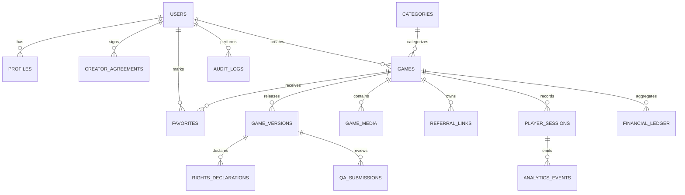

# GameVerse: Relational Database Schema Specification
**Database Engine:** PostgreSQL 16  
**ORM:** Prisma / Drizzle ORM (Type-Safe TypeScript)  

---

## 1. Entity-Relationship Overview



---

## 2. Core Tables DDL / Prisma Schema

```prisma
datasource db {
  provider = "postgresql"
  url      = env("DATABASE_URL")
}

generator client {
  provider = "prisma-client-js"
}

enum UserRole {
  GUEST
  PLAYER
  DEVELOPER
  MODERATOR
  FINANCE
  ADMIN
  SUPER_ADMIN
}

enum GameStatus {
  DRAFT
  SUBMITTED
  PROCESSING
  SECURITY_REVIEW
  QA_TESTING
  CHANGES_REQUESTED
  APPROVED
  PUBLISHED
  REJECTED
  SUSPENDED
  UNPUBLISHED
}

enum AIDisclosure {
  NONE_HUMAN_ONLY
  AI_ASSISTED
  AI_GENERATED
}

model User {
  id                String             @id @default(uuid())
  email             String             @unique
  passwordHash      String
  role              UserRole           @default(PLAYER)
  emailVerified     Boolean            @default(false)
  twoFactorEnabled  Boolean            @default(false)
  twoFactorSecret   String?
  createdAt         DateTime           @default(now())
  updatedAt         DateTime           @updatedAt

  profile           Profile?
  creatorAgreements CreatorAgreement[]
  games             Game[]
  favorites         Favorite[]
  auditLogs         AuditLog[]
  payouts           FinancialLedger[]
}

model Profile {
  id          String   @id @default(uuid())
  userId      String   @unique
  user        User     @relation(fields: [userId], references: [id], onDelete: Cascade)
  username    String   @unique
  displayName String?
  avatarUrl   String?
  bio         String?
  studioName  String?
  website     String?
  socialLinks Json?
  createdAt   DateTime @default(now())
}

model CreatorAgreement {
  id               String   @id @default(uuid())
  userId           String
  user             User     @relation(fields: [userId], references: [id], onDelete: Cascade)
  agreementVersion String
  acceptedAt       DateTime @default(now())
  ipAddress        String
  accountStatus    String   @default("ACTIVE")
}

model Category {
  id          String   @id @default(uuid())
  name        String   @unique
  slug        String   @unique
  description String?
  icon        String?
  sortOrder   Int      @default(0)
  games       Game[]
}

model Game {
  id               String          @id @default(uuid())
  developerId      String
  developer        User            @relation(fields: [developerId], references: [id], onDelete: Cascade)
  categoryId       String
  category         Category        @relation(fields: [categoryId], references: [id])
  slug             String          @unique
  title            String
  shortDescription String
  fullDescription  String
  controlsGuide    String?
  engine           String          @default("HTML5")
  orientation      String          @default("LANDSCAPE") // LANDSCAPE, PORTRAIT, ANY
  status           GameStatus      @default(DRAFT)
  isFeatured       Boolean         @default(false)
  publishedAt      DateTime?
  createdAt        DateTime        @default(now())
  updatedAt        DateTime        @updatedAt

  versions         GameVersion[]
  media            GameMedia[]
  referralLinks    ReferralLink[]
  sessions         PlayerSession[]
  favorites        Favorite[]
  ledgerRecords    FinancialLedger[]
}

model GameVersion {
  id               String             @id @default(uuid())
  gameId           String
  game             Game               @relation(fields: [gameId], references: [id], onDelete: Cascade)
  versionNumber    String
  changelog        String?
  entryFile        String             @default("index.html")
  archivePath      String
  archiveChecksum  String
  archiveSizeBytes BigInt
  scanResults      Json?
  createdAt        DateTime           @default(now())

  rights           RightsDeclaration?
  qaSubmissions    QaSubmission[]
}

model RightsDeclaration {
  id                String       @id @default(uuid())
  versionId         String       @unique
  version           GameVersion  @relation(fields: [versionId], references: [id], onDelete: Cascade)
  aiDisclosure      AIDisclosure @default(NONE_HUMAN_ONLY)
  thirdPartyAssets  Boolean      @default(false)
  licensingNotes    String?
  rightsConfirmed   Boolean      @default(false)
  confirmedAt       DateTime     @default(now())
}

model QaSubmission {
  id              String      @id @default(uuid())
  versionId       String
  version         GameVersion @relation(fields: [versionId], references: [id], onDelete: Cascade)
  reviewerId      String?
  status          GameStatus  @default(SUBMITTED)
  automatedChecks Json?
  manualNotes     String?
  rejectionReason String?
  reviewedAt      DateTime?
  createdAt       DateTime    @default(now())
}

model GameMedia {
  id        String   @id @default(uuid())
  gameId    String
  game      Game     @relation(fields: [gameId], references: [id], onDelete: Cascade)
  type      String   // THUMBNAIL, BANNER, SCREENSHOT
  url       String
  sortOrder Int      @default(0)
}

model PlayerSession {
  id            String           @id @default(uuid())
  gameId        String
  game          Game             @relation(fields: [gameId], references: [id], onDelete: Cascade)
  playerId      String?
  sessionToken  String           @unique
  ipHash        String
  deviceType    String?
  browser       String?
  referralToken String?
  startTime     DateTime         @default(now())
  endTime       DateTime?
  activeSeconds Int              @default(0)

  events        AnalyticsEvent[]
}

model AnalyticsEvent {
  id        String        @id @default(uuid())
  sessionId String
  session   PlayerSession @relation(fields: [sessionId], references: [id], onDelete: Cascade)
  eventType String
  metadata  Json?
  timestamp DateTime      @default(now())
}

model ReferralLink {
  id            String   @id @default(uuid())
  gameId        String
  game          Game     @relation(fields: [gameId], references: [id], onDelete: Cascade)
  creatorId     String
  token         String   @unique
  clicks        Int      @default(0)
  uniquePlayers Int      @default(0)
  createdAt     DateTime @default(now())
}

model FinancialLedger {
  id             String    @id @default(uuid())
  creatorId      String
  creator        User      @relation(fields: [creatorId], references: [id], onDelete: Cascade)
  gameId         String?
  game           Game?     @relation(fields: [gameId], references: [id])
  periodStart    DateTime
  periodEnd      DateTime
  grossRevenue   Decimal   @db.Decimal(12, 4)
  deductions     Decimal   @db.Decimal(12, 4)
  netCreatorShare Decimal  @db.Decimal(12, 4)
  status         String    @default("PENDING") // PENDING, FINALIZED, PAID, VOID
  transactionRef String?
  paidAt         DateTime?
  createdAt      DateTime  @default(now())
}

model Favorite {
  id        String   @id @default(uuid())
  userId    String
  user      User     @relation(fields: [userId], references: [id], onDelete: Cascade)
  gameId    String
  game      Game     @relation(fields: [gameId], references: [id], onDelete: Cascade)
  createdAt DateTime @default(now())

  @@unique([userId, gameId])
}

model AuditLog {
  id         String   @id @default(uuid())
  actorId    String
  actor      User     @relation(fields: [actorId], references: [id])
  action     String
  targetType String
  targetId   String
  details    Json?
  ipAddress  String
  createdAt  DateTime @default(now())
}
```
