# GameVerse: Phase Dependency Map & Release Phasing
**Version:** 1.0.0  

---

## 1. Master Phasing Overview

```mermaid
flowchart TD
    P0["Phase 0: Requirements & Validation"] --> P1["Phase 1: UI/UX Design System"]
    P1 --> P2["Phase 2: Backend, Database & Auth Core"]
    P2 --> P3["Phase 3: Developer Portal & Studio Onboarding"]
    P3 --> P4["Phase 4: Game Submission & ZIP Processing"]
    P4 --> P5["Phase 5: Admin Portal & QA Review Workspace"]
    P5 --> P6["Phase 6: Main Gaming Website & Catalog"]
    P6 --> P7["Phase 7: Game Player & Sandboxed Fullscreen"]
    
    subgraph Release1 ["Release 1: Core MVP (Vertical Slice)"]
        P0
        P1
        P2
        P3
        P4
        P5
        P6
        P7
    end

    P7 --> P8["Phase 8: Player Analytics Pipeline"]
    P8 --> P9["Phase 9: Developer Analytics & Dashboards"]
    P9 --> P10["Phase 10: Social Promotion & Referral Engine"]
    P10 --> P11["Phase 11: Ads & Monetization Integration"]
    P11 --> P12["Phase 12: Earnings & Double-Entry Payouts"]

    subgraph Release2 ["Release 2: Analytics, Monetization & Payouts"]
        P8
        P9
        P10
        P11
        P12
    end

    P12 --> P13["Phase 13: Player Community, Profiles & Social"]
    P13 --> P14["Phase 14: Security Hardening, Privacy & Legal"]
    P14 --> P15["Phase 15: Performance, CDN & Stress Testing"]
    P15 --> P16["Phase 16: Beta Onboarding & Public Launch"]

    subgraph Release3 ["Release 3: Scale, Community & Launch"]
        P13
        P14
        P15
        P16
    end
```

---

## 2. Phase-by-Phase Dependency Analysis

| Phase ID | Phase Name | Direct Pre-requisites | Blocks Following Phases | Key Technical Deliverable |
| :--- | :--- | :--- | :--- | :--- |
| **Phase 0** | Requirements & Validation | None | Phase 1 | Requirements spec, policy outlines, legal templates |
| **Phase 1** | UI/UX Design System | Phase 0 | Phase 2, 3, 5, 6 | Design tokens, components, responsive wireframes |
| **Phase 2** | Backend, DB & Auth | Phase 1 | Phase 3, 5, 6 | PostgreSQL schema, migrations, JWT/Sessions, RBAC guards |
| **Phase 3** | Developer Portal | Phase 2 | Phase 4 | Studio onboarding, legal acceptance, developer dashboard |
| **Phase 4** | Game Submission & ZIP | Phase 3 | Phase 5 | Secure archive uploader, file scanner, version control |
| **Phase 5** | Admin Portal & QA | Phase 4 | Phase 6, 7 | Review queue, sandboxed preview, state machine approval |
| **Phase 6** | Main Gaming Website | Phase 2, 5 | Phase 7 | Catalog discovery, game landing pages, categories, search |
| **Phase 7** | Game Player & Fullscreen | Phase 5, 6 | Phase 8 | Isolated iframe player, aspect ratios, HUD controls |
| **Phase 8** | Player Analytics | Phase 7 | Phase 9, 10 | Telemetry collector, active playtime filter, event stream |
| **Phase 9** | Developer Analytics | Phase 8 | Phase 10, 12 | Per-game analytics dashboard, retention/conversion charts |
| **Phase 10**| Social Promotion & Referrals | Phase 9 | Phase 11, 12 | Opaque referral link generator, attribution tracker |
| **Phase 11**| Ads & Monetization | Phase 8, 10 | Phase 12 | Ad network provider bridge, impression/revenue tracking |
| **Phase 12**| Earnings & Payouts | Phase 11 | Phase 13 | Reconciliation ledger, creator share engine, payout admin |
| **Phase 13**| Player Account & Community | Phase 6, 7 | Phase 14 | Profiles, favorites, recently played, ratings/reviews |
| **Phase 14**| Security, Privacy & Legal | All prior | Phase 15 | Origin isolation, CSP audit, DPDP/GDPR compliance |
| **Phase 15**| Performance & Reliability | Phase 14 | Phase 16 | CDN edge caching, 5K concurrency load test, backups |
| **Phase 16**| Beta & Public Launch | Phase 15 | Live Operation | Creator onboarding (10-20 devs), monitoring, public release |

---

## 3. Strict Scope Boundaries
- **No Early Phase Leakage:** Features belonging to Phase 8+ (e.g. ad networks, financial payouts, community comments) will NOT be prematurely stubbed or implemented in Phase 1-7.
- **Architectural Readiness:** Foundational schema entities (like `User`, `Game`, `GameVersion`) are provisioned with future-compatible foreign keys, but active business logic is strictly activated in their respective phase.
